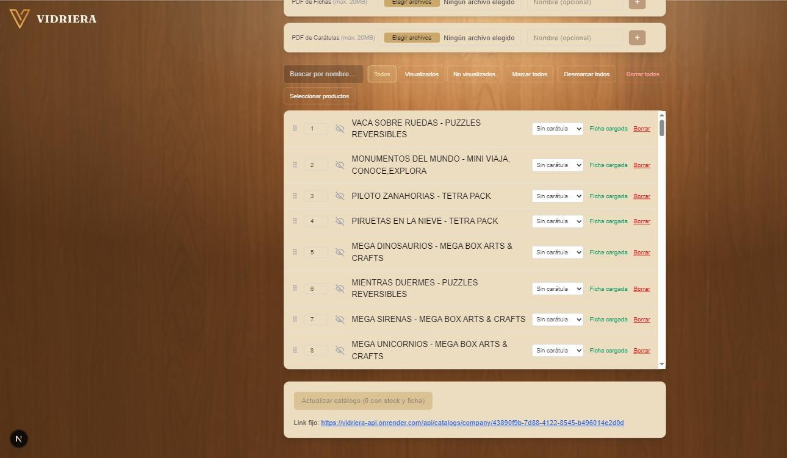
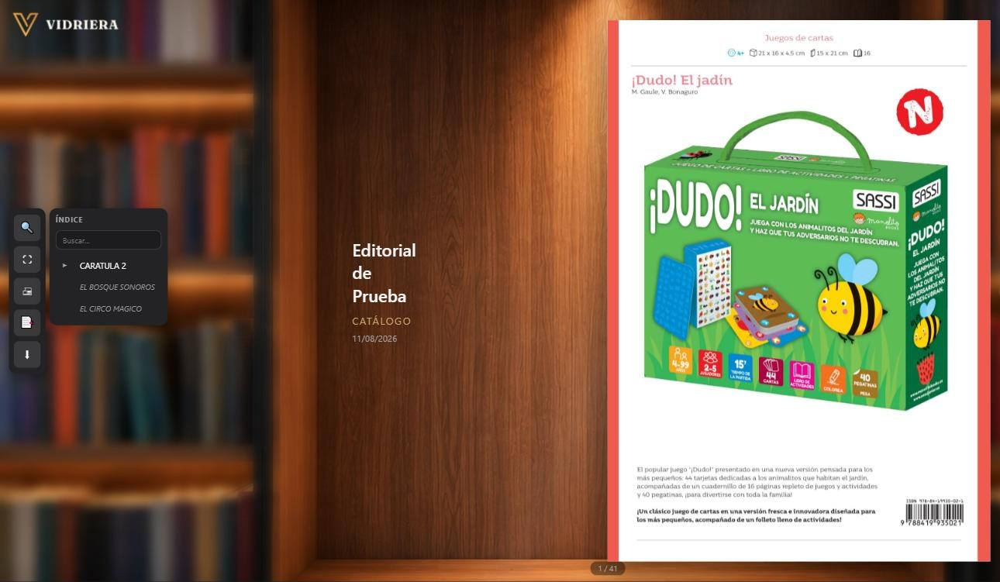
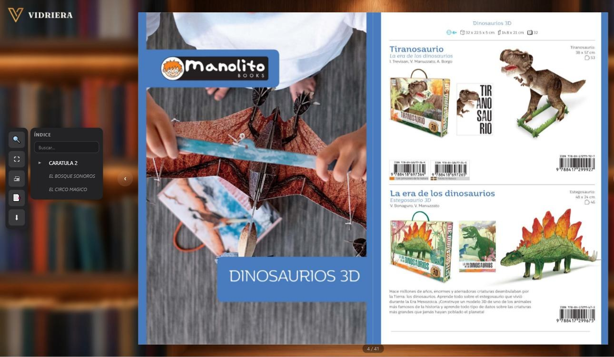
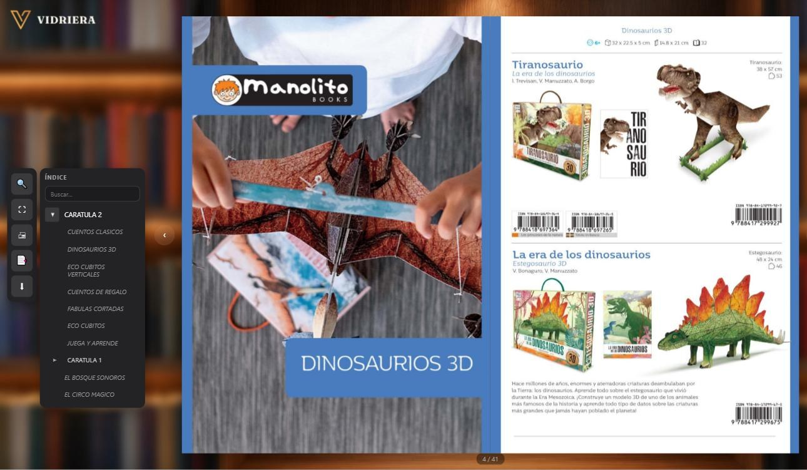
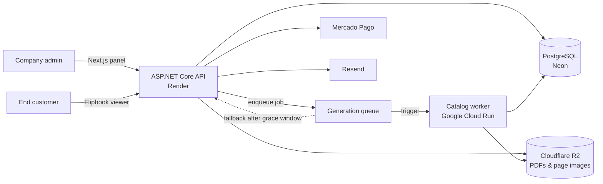

  

<h1 align="center">Vidriera</h1>

  <b>Turn a pile of product PDFs into a magazine-style digital catalog — one link, always up to date.</b> 
  <a href="#español">Leer en español ↓</a>

---

> This is a **showcase repository**. Vidriera is a commercial SaaS in production; its source code is private.
> Here you'll find what it does, how it's built, and a curated selection of real code from the project.

## What it does

Businesses (publishers, distributors, toy stores…) upload one PDF sheet per item, optionally grouped under section covers and sub-sections. Vidriera merges them into a single catalog and publishes it as an interactive **flipbook**:

- Page-flip reading experience on desktop, tablet and phone
- Collapsible, searchable index of sections and items
- **One fixed link**: every new version replaces the previous one at the same URL (or the company's custom domain)
- Bulk upload of sheets and covers, drag-and-drop ordering, stock selection
- Excel import for prices and availability
- Built-in order cart & checkout so customers can send orders straight from the catalog
- Magnifier zoom that transparently swaps in high-resolution pages
- Monthly subscriptions via Mercado Pago, transactional email via Resend

## Screenshots

| Admin panel | Catalog cover |
|---|---|
|  |  |
| **Two-page spread** | **Expanded index with search** |
|  |  |

## Architecture

**Catalog generation pipeline**

1. The item/section tree is flattened into a *merge plan*; a content fingerprint lets unchanged catalogs be reused instead of regenerated.
2. PDFs are merged (PdfSharpCore) into a single document.
3. Pages are rasterized with PDFium to WebP — once at normal resolution and later, in the background, at HD for zoom.
4. Images are uploaded to R2 in parallel, while PDFium itself stays sequential (it isn't thread-safe).
5. Jobs run on a dedicated Cloud Run worker; if it doesn't pick a job up within a grace window, the API processes it itself.

## Tech stack

| Layer | Tech |
|---|---|
| Backend | .NET 10, ASP.NET Core, Clean Architecture (Domain / Application / Infrastructure / Api), MediatR (CQRS) |
| Persistence | PostgreSQL, NHibernate, DbUp migrations |
| Documents | PdfSharpCore (merge), PDFium via PDFtoImage + SkiaSharp (rasterization), ClosedXML (Excel) |
| Storage | Cloudflare R2 (S3 API) |
| Frontend | Next.js 16, React 19, TypeScript, Tailwind CSS 4 |
| Viewer | Vanilla ES modules, no framework |
| Infra | Render (API), Neon (DB), Google Cloud Run (worker), Docker |
| Payments / email | Mercado Pago subscriptions, Resend |
| Tests | xUnit (application layer), Node test runner (viewer) |

## Code samples

Real files from the private codebase, copied unchanged:

| File | What it shows |
|---|---|
| [`CatalogMergePlanBuilder.cs`](snippets/backend/CatalogMergePlanBuilder.cs) | Turns a nested section/item tree into an ordered merge plan, a content fingerprint and the page-numbered index |
| [`CatalogGenerationWorker.cs`](snippets/backend/CatalogGenerationWorker.cs) | Background queue consumer with orphaned-job recovery and fallback to an external Cloud Run worker |
| [`CatalogHdPagesGenerator.cs`](snippets/backend/CatalogHdPagesGenerator.cs) | Low-priority HD rendering that yields to user-facing jobs and cleans up if the catalog gets replaced mid-run |
| [`CatalogGenerationGate.cs`](snippets/backend/CatalogGenerationGate.cs) | Tiny semaphore wrapper that lets background work detect waiting high-priority jobs |
| [`PdfiumRasterizerService.cs`](snippets/backend/PdfiumRasterizerService.cs) | Streaming PDF → WebP rasterization as an `IAsyncEnumerable` |
| [`hd-pages.js`](snippets/frontend/hd-pages.js) | Viewer module that preloads and swaps in HD images only for pages that stay visible |
| [`zoom.js`](snippets/frontend/zoom.js) | Click-to-zoom magnifier that follows the cursor and drives the HD upgrader |
| [`useCatalogGeneration.ts`](snippets/panel/useCatalogGeneration.ts) | React hook for the admin panel: enqueues a generation job, polls progress, resumes an in-flight job after a page reload and supports cancellation |
| [`CatalogPanel.tsx`](snippets/panel/CatalogPanel.tsx) | The "update catalog" card: stage-aware progress bar, price toggle and the fixed share link |

## Contact

Interested in Vidriera for your business? **contacto@vidriera.app**

---

# 🇦🇷 Español

> Este es un **repositorio de muestra**. Vidriera es un SaaS comercial en producción y su código es privado.
> Acá vas a encontrar qué hace, cómo está construido y una selección de código real del proyecto.

## Qué es

Vidriera convierte las fichas PDF de tus items en un **catálogo digital tipo revista**: se hojea como un libro, tiene índice navegable con buscador y funciona igual en computadora, tablet o celular. Cada vez que actualizás stock o agregás items generás una nueva versión **sin cambiar el link** que ya compartiste.

Pensado para editoriales, distribuidoras, jugueterías y cualquier negocio que hoy arma su catálogo en PDF.

## Funcionalidades

- Visor flipbook responsive, con índice de carátulas y subcarátulas y buscador
- Link fijo (o dominio propio de la empresa), siempre con la última versión
- Carga masiva de fichas y carátulas, orden por arrastre, selección por stock
- Importación de precios y disponibilidad desde Excel
- Carrito y formulario de pedidos dentro del catálogo
- Lupa con reemplazo automático por páginas en alta resolución
- Suscripciones mensuales con Mercado Pago y emails con Resend

## Arquitectura

Backend en **.NET 10** con Clean Architecture y MediatR, **PostgreSQL** (Neon) con NHibernate, archivos en **Cloudflare R2**, panel en **Next.js 16**, y un worker en **Google Cloud Run** que genera los catálogos (unir PDFs, rasterizar páginas con PDFium y subirlas a R2). Si el worker no toma un trabajo dentro de un margen de tiempo, la API lo procesa sola. El diagrama y el detalle están [arriba](#architecture).

## Código de ejemplo

Archivos reales del proyecto, copiados sin cambios: ver la tabla de [Code samples](#code-samples).

## Contacto

¿Querés tu propio catálogo? **contacto@vidriera.app**

---

© 2026 Franco Amato. All rights reserved. The code in this repository is shown for portfolio purposes only and is not licensed for reuse. / Todos los derechos reservados. El código se muestra solo como portfolio y no está licenciado para su reutilización.
